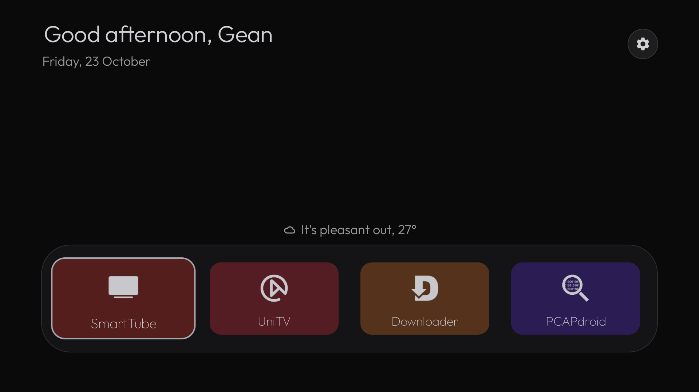
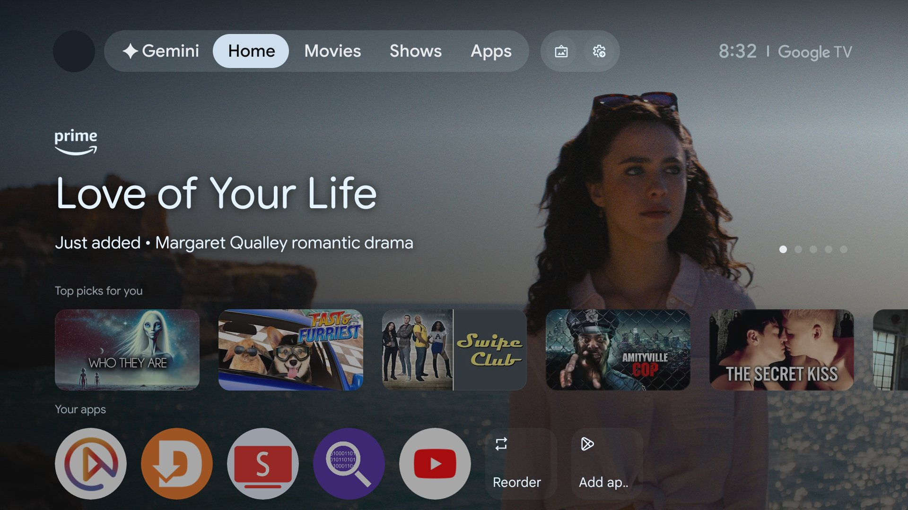
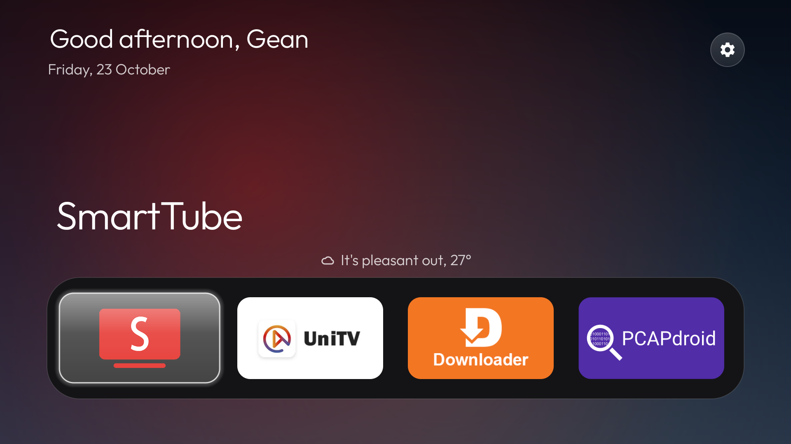
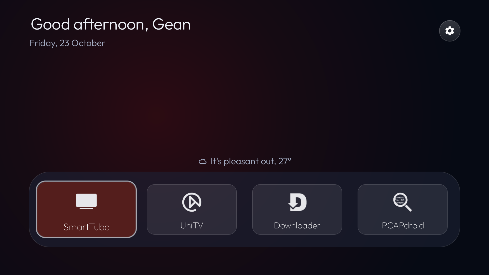
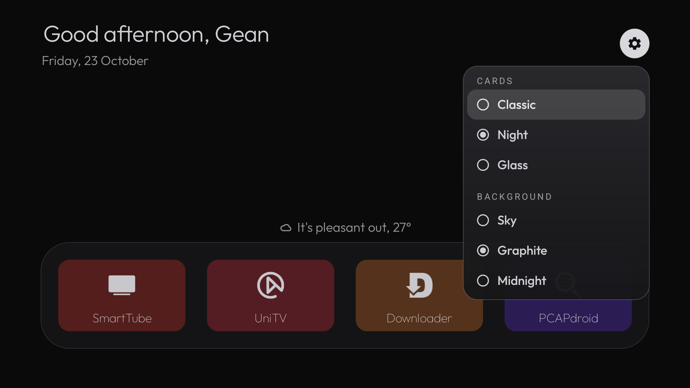
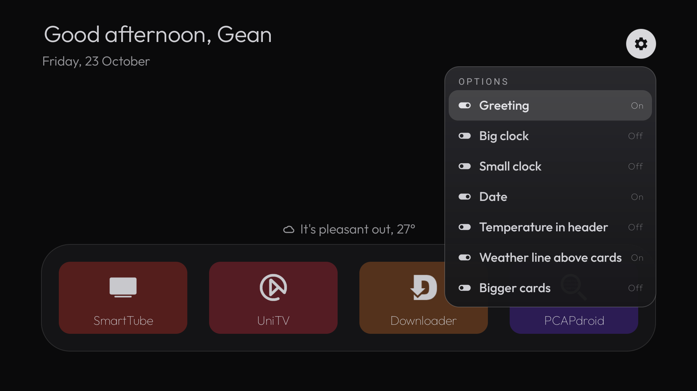
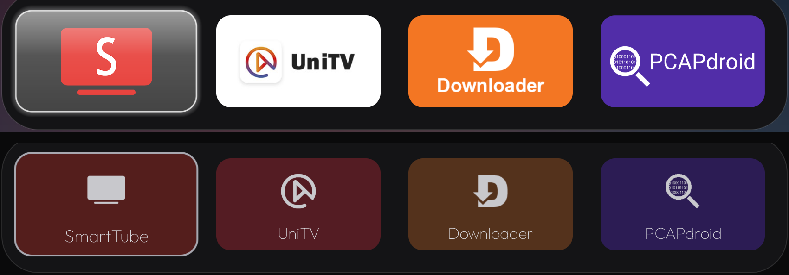
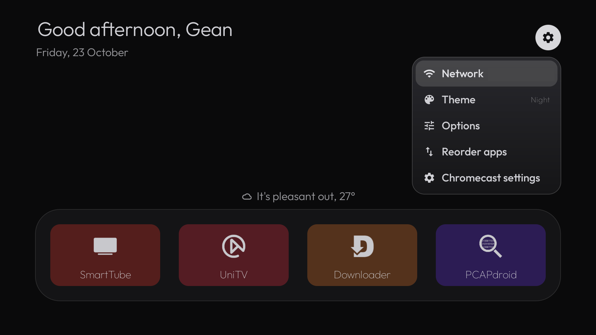

# Night Home for Chromecast with Google TV

An ad-free home screen for a Chromecast with Google TV 4K, designed for a dark bedroom and easy reading: no glaring whites, calm colors, big text, and only the apps I actually use.

It is a personal project built on top of [cleanyourtv](https://github.com/Gathin23/cleanyourtv), which gave me the debloat tooling and the base launcher. Everything in this repository is what I designed and added on top of it.



## Before and after

| Stock Google TV home | Night Home |
|---|---|
|  |  |

The stock home is mostly promoted content. Night Home shows a greeting, the time, the current weather and four apps, and nothing else.

## What I built

### Three card styles and three backgrounds, changed live from the remote

A **Theme** panel in the gear menu switches the card style and the background. Every click applies at once; there is no Save button.

| Classic + Sky | Night + Graphite | Glass + Midnight |
|---|---|---|
|  |  |  |

- **Classic**: the launcher's original look, with app banners and the big title of the focused app.
- **Night**: made for a dark room and low vision. No solid white anywhere, no colored glow, muted text with at least 4.5:1 contrast, and a grey focus ring flush with the card. Each card gets a dark, desaturated tone derived from the app's own color.
- **Glass**: neutral translucent cards; only the focused card takes the app's color.



### Every option is an independent switch

The **Options** panel holds seven switches that combine freely: greeting, big clock, small clock, date, temperature in the header, weather line above the cards, and bigger cards. No switch turns another one on or off.



### App icons reduced to one-color drawings, all the same size

In Night and Glass, every app icon becomes just its drawing, in one soft color, without the square background that most icons ship with. This works for any installed app, not only the ones in the screenshots.



*Top: the original icons (Classic). Bottom: the same apps in Night.*

How it works (`IconInk.java`, plain Java, unit-tested):

1. Take the best source the app provides: its monochrome icon (Android 13+), else the foreground layer of its adaptive icon, else the whole icon.
2. Find a solid background color by majority vote on a ring of samples 6% inside the edges. A logo that crosses part of the ring does not stop the detection, and a color is removed only if a drawing actually sits on it, so a plain glyph with no backdrop is kept.
3. Turn each pixel's distance from that background into an alpha mask, and paint the mask in one color.
4. Crop the mask to the drawing's bounds and fit it into one box, centered with its shape kept. Icons ship with very different margins, so without this step some drawings looked half the size of others.

### Current weather, without an API key

The current temperature and condition come from [Open-Meteo](https://open-meteo.com/) for the system's last known location, refreshed every 30 minutes off the main thread. A short phrase sits above the cards ("It's raining, 19°", "It's a bit cool, 17°"), in English or Portuguese following the system language. The position is rounded to about 1 km before it leaves the device. With no location or no network, the weather simply does not show; the screen never breaks.

### Made for a TV remote over HDMI-CEC

The TV is driven by a Samsung remote over HDMI-CEC, which does not reliably send long-press or the Menu key. So everything is one click away in the gear menu: Network, Theme, Options, Reorder apps and Chromecast settings. When focused, the gear inverts its colors, so it is obvious where focus is.



## How it is built

- Plain Java and Android Views, matching the base launcher (no Kotlin, no Compose, no new dependencies).
- Rules live in pure classes that run as plain JVM unit tests: `HomeLook` (choices, defaults, colors, contrast), `IconInk` (icon drawing extraction) and `WeatherNow` (response parsing, cache validity, weather phrases). Android-facing code stays thin: `LookPrefs`, `LookHeader`, `LookTiles`, `LookMenus` and `WeatherClient`.
- Changes to the base launcher's own files are small hooks, to keep rebasing on new versions easy.
- Choices are saved in their own preferences file, so applying a cleanyourtv theme does not reset them.
- 215 launcher unit tests pass, including 33 for this project's rules.
- The work followed a written spec, decision records (ADRs) and task lists per delivery, with an interactive prototype first and screenshots from the real TV as acceptance checks.

## Use it on your own TV

The changes are in [`night-home.patch`](night-home.patch); the same files are browsable under [`launcher/`](launcher/). The patch applies to cleanyourtv at commit [`34e1c42`](https://github.com/Gathin23/cleanyourtv/commit/34e1c42). Newer versions of cleanyourtv changed `MainActivity.java`, so on a newer base expect to merge that one file by hand.

```bash
git clone https://github.com/Gathin23/cleanyourtv
cd cleanyourtv
git checkout -b night-home 34e1c42
git apply /path/to/chromecast-night-home/night-home.patch
```

Then follow cleanyourtv's README to pair with the TV over ADB, debloat it and install the launcher. For a Chromecast with Google TV 4K, the two lists in [`debloat/`](debloat/) are what I used:

- `debloat-only.txt`: telemetry, ads and preloaded apps, keeping phone casting and the stock home.
- `launcher-mode.txt`: disables the setup wizard so the new launcher can take over Home. Phone casting stops working after each reboot of the Chromecast until it is re-enabled.

[`theme/config.json`](theme/config.json) is my theme. Change `greeting_name` to your own name before applying it.

These are changes to the home screen of a device you own, done over ADB. Read cleanyourtv's README and restore notes before running anything.

## Credits and license

- Base launcher and tools: [cleanyourtv](https://github.com/Gathin23/cleanyourtv) by Gathin, MIT.
- Weather data: [Open-Meteo](https://open-meteo.com/), CC BY 4.0.
- Night Home changes: Gean Lopes, MIT. See [`LICENSE`](LICENSE).

This is a personal showcase, not affiliated with Google or with the cleanyourtv project.
